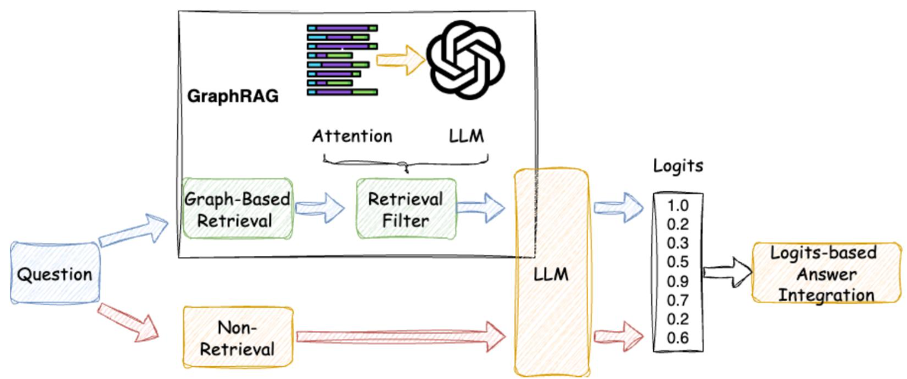

| 方法         | 图主要用来做什么                                     | 查询时的核心流程                                             |
| ------------ | ---------------------------------------------------- | ------------------------------------------------------------ |
| **GraphRAG** | 建立实体图，并预先**生成**相关实体群组的**社区摘要** | 查询时**根据相关社区摘要生成局部回答**，再汇总成最终回答     |
| **LightRAG** | 支持实体关系检索，也支持更高层主题检索               | 从问题提取低层和高层**关键词**，分别检索具体**实体**关系和较宽泛**主题**，再把检索结果交给 LLM |
| **KG²RAG**   | 连接文本块中的事实，辅助**扩展**和组织证据           | 先语义检索**种子块**，再沿 KG **扩展相关块**，用最大生成树**筛选**和组织，最后**重排** |
| **GRAG**     | **检索相关文本子图**，并用图编码器保留拓扑结构       | 先检索 **K-hop ego-graph**，编码局部子图和问题，**比较子图与问题向量进行初筛**top-N，再进行 **soft 剪枝**：**比较节点/边表示与问题表示得到权重**，最后用双视图：**层次化文本 + GAT聚合结果**增强 LLM |
| **G-Retriever** | 从文本图中检索与问题相关的节点和边，并**构造连通子图** | 先做节点/边语义 **Top-K** 检索，再用 **PCST** 选择高奖励、低成本的连通子图，最后结合**子图文本**与**图编码 soft prompt**交给 LLM |

# 一、基础

## 1.KG²RAG:Knowledge Graph-Guided Retrieval Augmented Generation

**离线阶段：构建知识图谱**

> **① 文档切分**
> 原始文档 → 按句子、段落和预设长度==切分为文本块==。

↓

> **② 抽取事实并建立关联**
> ==用 Prompt 指导 LLM 抽取三元组== `(头实体, 关系, 尾实体)`。
> 合并为==知识图谱==，并记录每条事实的来源文本块：`(h, r, t, c)`。
> 保存文本块向量、知识图谱及来源映射。

------

**在线阶段：检索、组织与生成**

> **③ 语义检索：找到入口**
> ==计算问题与文本块的向量余弦相似度==。
> 选取 **top-k ==种子文本块==**，取出其对应的初始子图。

↓

> **④ 图引导扩展：补全相关证据**
> 从初始子图中的实体出发，用 **BFS 扩展 m 跳邻居**。
> 得到==扩展子图==，并根据事实来源取回对应文本块。

↓

> **⑤ 图结构==筛选==：压缩事实连接**
> 将==子图转为无向加权图==，**边权 = 来源文本块与问题的相似度**。
> 划分连通分量，==为每个分量构建**最大生成树（MST）**==，削减冗余边。

↓

> **⑥ 上下文组织与重排：整理证据**
> **文本表示**：以最高权重边为起点，按 DFS 顺序拼接来源文本块。
> **三元组表示**：拼接==树中的三元组==，供 Cross-Encoder ==与问题一起打分==。
> 按==树的得分排序，依次选入对应文本，直到达到 **k 个文本块上限**==。

↓

> **⑦ LLM 生成答案**
> 将 **用户问题 + 组织后的原文段落** 输入 LLM，生成最终答案。

*参数：k 为文本块数量预算，m 为扩展跳数；论文默认实验设置为 k = 10、m = 1。*

构建**MST**：对一个含有 \(n\) 个节点的连通分量，生成树需要：（去掉低权的重复边，去掉低权的环，例如1-2-3，则去除1-3.因为已有路径）

- 保留全部节点；
- 保持节点之间连通；
- 不包含环，因此只保留 \(n-1\) 条边。
- 在所有可能的生成树中，选择**边权之和最大**的一棵

## 2.GRAG: Graph Retrieval-Augmented Generation

原文提出一个假设：==有用的答案子图g，通常可以由一些**关键节点** v 及其部分邻居N(v)组成。==
$$
\hat g = \bigcup_{v\in V_{\mathrm{key}}} G[N_K^*(v)]
$$
直接评价多个局部图合并后的整体质量仍然困难。原文因此做了一个近似：分别评价每个关键节点周围的局部图，然后把局部得分加起来。(这里的 \(f(g)\) 表示：如果把子图 \(g\) 提供给生成模型，模型回答问题的质量如何。)
$$
\max_{V_{\mathrm{key}}}
f\left(
\bigcup_{v\in V_{\mathrm{key}}}G[N_K^*(v)]
\right)
\approx
\max_{V_{\mathrm{key}}}
\sum_{v\in V_{\mathrm{key}}}
f(G[N_K^*(v)])
$$
**离线阶段：建立文本图索引**

> **① 输入文本图**
> 输入已经存在的==带文本属性的图==：
> 节点有自然语言描述，边也有自然语言关系描述。

↓

> **② 构造局部子图**
> 以每个节点 \(v\) 为中心，提取其 **K-hop ego-graph**：\($G[N_K(v)]$\)    K跳自我图。

↓

> **③ ==编码局部子图==**
> 用 Sentence-BERT 编码 ego-graph 中的节点文本和边文本，
> 通过 **mean pooling** 得到**子图向量 \($z_g$\)**，保存用于后续检索。
> $$
>  z_g = \operatorname{POOL} \left( \operatorname{PLM} \left( \{T_n\}_{n\in V_g}, \{T_e\}_{e\in E_g} \right) \right) 
> $$
> 其中：
>
> - \(Tn\)：节点的文本属性；(Te\)：边的文本属性；
> - \(PLM)：把自然语言文本转换成向量；
> - \(POOL\)：把**多个**节点和边的**向量聚合**成**一个**子图向量；（每一个维度分别求平均）
> - \($z_g$\)：整个 ego-graph 的向量表示。

------

**在线阶段：子图检索、剪枝与生成**

> **④ 语义检索：找到相关局部图**
> 用同一个 Sentence-BERT 将**问题编码**为 **\($z_q$\)**。
> 计算 \($z_q$\) 与各 ego-graph 向量的**余弦相似度**，（==比较子图与问题==）
> 选取 **top-N 个相关 ego-graph**。（==初筛子图==）

↓

> **⑤ ==Soft Pruning（轻剪枝）==：不直接删除某节点或边，用较小权重降低其影响**
> 分别计算节点、边文本与问题的向量距离，
> 用两个 MLP 得到相关性缩放因子$\alpha$。
> $$
> z_n=\operatorname{PLM}(T_n),\qquad
> \alpha_n=\operatorname{MLP}_{\phi_1}(z_n\ominus z_q)
> \qquad
> 
> z_e=\operatorname{PLM}(T_e),\qquad
> \alpha_e=\operatorname{MLP}_{\phi_2}(z_e\ominus z_q)
> $$
> \(PLM)：把自然语言文本转换成向量；==比较节点/边表示与问题表示==（$\ominus$为**逐元素距离操作**。）；将这个差异送入**不同的 MLP学习**；
>
> 与问题越不相关，相关性缩放因子越接近 0。
> **合并经过自适应缩放的 top-N 个 ego-graph**，得到面向问题的近似最优子图 \(g\)。

↓

> **⑥ ==Text View：把子图转换为层次化文本==**
> 对 ego-graph 用 BFS 找到**以中心节点为根的树** \($T_g$\)。
> 再将**不属于树的额外边**记为 \($E_g$\)，即$g=T_g\cup E_g$
>
> 对 \($T_g$\) 做先序遍历，用缩进表示层级，
> 并把 \($E_g$\) 中的额外关系作为三元组插入文本描述 \(结果记为$D_g$\)。
>
> 最后用 LLM 自己的 text embedder，将它转换成文本 embedding。

↓

> **⑦ ==Graph View：把拓扑结构编码为图 token==**
> 将节点、边的文本向量输入 GAT。
> **使用 \(缩放因子$\alpha$\) 控制消息传递，降低无关节点和边的影响**。消息公式是：
> $$
> m_u^{(l)}
> =
> \operatorname{MSG}^{(l)}
> \left(
> \alpha_u\cdot h_u^{(l-1)},
> \alpha_{uv}\cdot e_{uv}
> \right)
> $$
> \($\alpha_u$\)：节点相关性缩放因子；\($\alpha_{uv}$\)：边相关性缩放因子；
>
> 再用 MLP 将 GAT 输出**映射**到 LLM 的 token 向量空间，
> 得到图提示 \($h_{\hat g}$)。

↓

> **⑧ ==双视图增强生成==**
> 将用户问题和层次化文本描述作为 **==hard prompt==**，
> 将 GAT 输出作为 **==soft prompt==**。
> 拼接两种提示后输入 LLM：
> **问题 token 向量 + $D_g$的文本向量 + 图 token**。

## 3.G-Retriever: Retrieval-Augmented Generation for Textual Graph Understanding and Question Answering

**概述**：G-Retriever 面向**带文本属性的图**做问答：节点和边都有自然语言属性，系统既要找出与问题有关的图证据，又要保留证据之间的连接关系。核心是把**图检索表述为带奖 Steiner 树（PCST）优化**：相关节点/边获得较高“奖励”，选入子图需要付出边成本；在连通约束下，选择净收益较高的紧凑子图。随后把该子图同时编码成**图向量提示**和**文本描述**，交给 LLM 生成答案。

**贡献**：G-Retriever 提出 ==GraphQA 基准套件==（一种**图问答任务的基准设置**），统一整理了三个已有图问答数据集，可==测试不同类型的图理解与问答能力==；后续论文会选用其中全部或部分数据集进行评测，但 GraphQA 不是唯一的 GraphRAG 基准。

**贡献**：G-Retriever ==有效减少幻觉==，缓解“**整图被压缩成单一图嵌入**后，LLM 难以准确还原具体节点和关系”的信息瓶颈：它**同时向 LLM 提供相关子图的可读文本和图结构编码**，使模型能够依据更具体、可追溯的原图证据生成答案，减少凭语言模型参数自行补全或编造不存在节点、边的情况。

**局限**：论文指出当前检索组件是==静态==的，未来可研究可训练的检索器。

**离线阶段：建立图索引**

> **① 输入文本图**
> 输入图 \(G=(V,E)\)，每个节点 \(n\) 有文本属性 \($x_n$\)，每条边 \(e\) 有文本属性 \($x_e$\)。

↓

> **② 编码节点与边**
> 用预训练语言模型（论文实验中使用 Sentence-BERT）分别==编码节点文本和边文本==：
> $$
> z_n=\operatorname{LM}(x_n),\qquad z_e=\operatorname{LM}(x_e)
> $$
> 保存向量及其对应的节点/边，供在线相似度检索。

------

**在线阶段：检索、构图与生成**

> **③ 问题编码与语义初筛**
> 用同一语言模型==将问题== \($x_q$\) ==编码==为 \($z_q$\)，分别计算==问题与每个节点、每条边的余弦相似度==：
> $$
> z_q=\operatorname{LM}(x_q),\qquad
> V_k=\operatorname{TopK}_{n\in V}\cos(z_q,z_n),\quad
> E_k=\operatorname{TopK}_{e\in E}\cos(z_q,z_e)
> $$
> 得到候选相关节点 \($V_k$\) 和边 \($E_k$\)。这一步按语义相关性==筛选点、边==候选，**尚未保证候选组成连通子图**。

↓

> **④ ==PCST 子图构造==：兼顾相关性与连通性**（Prize-Collecting Steiner Tree）
> **按与问题的相关程度给 Top-K 节点和边分配奖励**（prize）：排名越靠前奖励越高，其余元素奖励为 0。然后**==在原图中寻找连通子图==** \(S=($V_S,E_S$)\)，**==最大化节点与边的总奖励==**，同时**惩罚子图中边的数量**：
> $$
> S^*=\arg\max_{\substack{S\subseteq G\\S\text{ 连通}}}
> \left[
> \sum_{n\in V_S}\operatorname{prize}(n)
> +\sum_{e\in E_S}\operatorname{prize}(e)
> -|E_S|C_e
> \right]
> $$
> \($C_e$\)：**每条入选边的预设成本**，用于控制子图规模；成本偏高时，方法倾向于只保留高价值、较紧凑的连接。
>
> 论文还将边的奖励纳入原本主要处理节点奖励的 PCST：边奖励 \($P_e$\) 不超过边成本 \($C_e$\) 时，可将边成本改为 \($C_e-P_e$\)；若 \($P_e>C_e$\)，则把边替换为连接其两个端点的虚拟节点，虚拟节点奖励为 \($P_e-C_e$\)，两条新边成本设为 0。这样就能用只处理节点奖励的 PCST 求解器表达边的语义奖励。

↓

> ⑤ ==**图编码**==：把拓扑变为 soft prompt，得到**图 token：补充结构信息**
> 将检索到的子图输入图神经网络编码器，论文方法描述中使用 GAT，并通过 mean pooling 得到图表示：
> $$
> h_g=\operatorname{POOL}(\operatorname{GNN}_{\phi_1}(S^*))
> $$
> 再用 MLP 投影到 LLM 的隐藏向量维度，得到图 token：
> $$
> \hat h_g=\operatorname{MLP}_{\phi_2}(h_g)
> $$

↓

> **⑥ ==图文本化==：保留语言模型擅长处理的可读语义**
> 将 \($S^*$\) 中的节点、边文本属性展开成文本，并与问题拼接，再经冻结 LLM 的文本嵌入层编码：
> $$
> h_t=\operatorname{TextEmbedder}([\operatorname{textualize}(S^*);x_q])
> $$

↓

> **⑦ ==双路提示生成答案==**
> 将**图 token \($\hat h_g$\)**（soft prompt）与**问题及子图文本的 token 向量 \($h_t$\)** 拼接，输入 LLM 的自注意力层生成答案：
> $$
> p(Y\mid S^*,x_q)=\prod_i p(y_i\mid y_{<i},[\hat h_g;h_t])
> $$
> 在冻结 LLM 的提示调优设置下，LLM 参数保持冻结，通过答案训练信号更新图编码器和投影层；论文也评估了进一步使用 LoRA 微调 LLM 的配置。

## 4.Empowering GraphRAG with Knowledge Filtering and Integration

**概述**：GraphRAG-FI（Filtering & Integration）是==可以接在已有 GraphRAG 检索器之后的增强框架==，包含两个部分：**GraphRAG-Filtering** 用“注意力粗筛 + LLM 精筛”**减少噪声**路径，同时保留一部分补充路径；**GraphRAG-Integration** 根据答案置信度筛选并合并 GraphRAG 与 LLM-only 的答案，**避免只依赖外部图知识而丢掉模型原本知道的答案**。

**整体流程：在已有 GraphRAG 上过滤证据并整合答案**

> **输入**：问题 \(q\)、现有 GraphRAG 检索器返回的路径或三元组集合 \($P=\{p_1,\ldots,p_N\}$\)，以及同一 LLM 对问题的独立回答。
>
> **输出**：过滤并分级后的图证据，以及合并 GraphRAG 与 LLM-only 高置信度候选后的答案。

↓

> **① ==注意力粗筛==：==使用LLM初步生成答案的注意力==**
> 把问题和所有检索路径组成 GraphRAG 提示，让 LLM 开始生成答案；从 LLM 的一个中间层读取**最后一个解码位置**（通常是生成**第一个答案 token 的位置**）对每条路径 token 的注意力。（**一条路径通常会被拆成多个 token**，模型计算注意力时是逐 token 分配的）
>
> 对路径 \($p_i$\)，设这些注意力值为 \($\operatorname{att}(p_i)$\)，按下式计算路径分数：
> $$
> \hat a_i=
> \frac{\max(\operatorname{att}(p_i))+
> \operatorname{mean}(\operatorname{att}(p_i))}{2}
> $$
> 即**结合路径中最高注意力和平均注意力；保留分数不低于阈值 \($\tau$\) 的路径：**
> $$
> P_{\mathrm{coarse}}=\{p_i\in P\mid \hat a_i\geq \tau\}
> $$

↓

> **② ==LLM 精筛==：确定高优先级证据**
> 将粗筛后路径交给 LLM，**==让LLM结合问题判断哪些路径有用==**，得到评价 \(f(p)\)。保留 LLM 选中的路径作为高优先级集合：
> $$
> P_{\mathrm{final}}=
> \{p\in P_{\mathrm{coarse}}\mid f(p)\geq\tau'\}
> $$
> \($\tau'$\) 不是固定数值阈值，而是由精筛 LLM 按提示直接挑出有用路径（附录提示要求只返回路径编号）。
>
> **重要：精筛未选中的粗筛路径并非全部删除。** 论文将\($P_{\mathrm{coarse}}-P_{\mathrm{final}}$\) 作为 **Additional Paths（补充路径）**

↓

> **③ ==分级组织图证据==：==重点路径在前，补充路径在后==**
> 构造回答提示时，将 \($P_{\mathrm{final}}$\) 放在 **High Priority Paths** 区域，将 \($P_{\mathrm{coarse}}-P_{\mathrm{final}}$\) 放在 **Additional Paths** 区域，分组列出并与问题一起输入 LLM。
>
> 这样精筛负责指出“最可信、最该优先使用”的证据，补充路径则保留可能有用但不够突出的线索。

↓

> **④ ==GraphRAG 与 LLM-only 分别生成候选答案==**
> 一路使用上述分级路径提示得到 GraphRAG 候选集合 \($A_G$\)；另一路只给同一个 LLM 问题，得到内部知识候选集合 \($A_L$\)。
>
> ==对两路的候选答案置信度进行筛选==。论文==将经过 softmax 的分数==记为 \($\ell_G(a)$\)、\($\ell_L(a)$\)==视为置信度进行过滤==，定义：
> $$
> A_G^{\mathrm{filtered}}=
> \{a\in A_G\mid \ell_G(a)\geq\tau_G\},\qquad
> A_L^{\mathrm{filtered}}=
> \{a\in A_L\mid \ell_L(a)\geq\tau_L\}
> $$
> 最终答案由==两组保留答案合并==得到：
> $$
> A_{\mathrm{final}}=
> \operatorname{Combine}\left(
> A_G^{\mathrm{filtered}},A_L^{\mathrm{filtered}}
> \right)
> $$

## 5.Evaluating and Improving Graph-to-Text Generation with Large Language Models

### 这篇论文在讲什么？

论文研究 **Graph-to-Text（图到文本生成）**：把知识图谱里的事实写成自然语言。知识图谱常用**三元组**表示一个事实，即“实体—关系—实体”，例如：

> `(Twitter, founded in, 2006)` → “Twitter 于 2006 年创立。”

论文想回答的是：大语言模型能否把一组这样的事实写得**通顺、完整，而且不编造**？它不是提出新的 GraphRAG 检索算法，而是通过实验分析生成端的问题，并尝试改进。

### 主要发现

- **图越复杂，模型越容易出错。** 输入事实变多后，模型更容易漏掉事实、弄乱表达顺序，或补充图中不存在的信息。文字读起来流畅，不代表内容一定忠于图。
- **只改提示词，帮助有限。** 给模型更清楚的任务说明有用；挑选难度适中、内容多样的示例也能带来一些提升，但总体不大。这里的 **few-shot** 是“在提示词里放几个示例，让模型照着学习”，不是重新训练模型。
- **DDD 是一种挑示例的方法。** DDD 同时考虑示例与当前输入有多相似（难度）以及示例之间是否多样。它避免只挑特别相似的例子，但实验显示这种提示词层面的改进仍有限。

### 论文做出了什么？

作者构建了 **PlanGTG**，一个约 2.9 万条训练样本的图到文本数据集，并用它微调模型。数据除了教模型“图怎么写成文本”，还加入两项练习：

- **重排（reordering）**：先把图里的事实排成更适合讲述的顺序。图中的关系本身不一定按自然语言叙述顺序排列。
- **事实归属（attribution）**：在生成文本的片段旁标出它对应哪个输入事实。这样可以检查模型有没有漏掉事实，或写出图中没有的内容。

可以把训练思路简单理解为：**先整理要讲的事实，再写成句子，并标明每句话依据什么。**

### 实验结果与意义

用 PlanGTG 微调后，模型在 WebNLG、DART 等多个测试集上的表现整体提高。例如，LLaMA2-7B-Chat 在 WebNLG17 上的 BLEU-4 从 **17.32** 提高到 **28.76**。BLEU-4 是把生成文本与参考答案进行词语匹配的自动分数；它能反映文本相似度，但**不能单独证明事实正确**，所以论文也做了人工事实核查。

**一句话总结：** 论文发现 LLM 做图到文本生成时，难点不只是把句子写通顺，更要先规划事实顺序并确保每句话有图中依据；DDD 提供有限的示例选择改进，PlanGTG 则通过“重排 + 标注事实来源”的训练，提升生成质量和事实对齐能力。对 GraphRAG 的启示是：检索到证据之后，如何组织证据并让答案忠于证据，同样重要。

